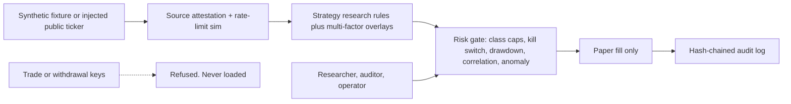

# Security architecture (v0.11)

Version 0.11 extends the control plane with Keltner-aware anomaly, portfolio correlation simulation, enhanced redaction, and rate-limit proxies. It is still a research design, not a certified security product and not legal advice.

## Trust boundaries

The system has no order router. `assert_paper_only` refuses any mode other than `PAPER`. `refuse_trade_secret` rejects names that look like trade, withdraw, transfer, or order credentials. Roles cannot enable live trading. Rate-limit simulation flags excessive signal generation.

## Roles

| Role | Allowed | Denied |
|---|---|---|
| Researcher | scan, backtest, read audit | place order, withdraw, enable live |
| Auditor | read audit, verify chain, scan | place order, withdraw, enable live |
| Operator | scan, kill switch, read audit | place order, withdraw, enable live |

There is no trader role. Promoting a signal to a broker is a separate system.

## Data classes

| Field | Class | Handling |
|---|---|---|
| Symbol, OHLCV | Public market | Synthetic in this repo |
| Funding rate | Public market | Research feature only |
| Source label | Integrity | Must be SYNTHETIC or PUBLIC_READ |
| Read-only market key | Secret, optional | Name must say read, market, or public. Never logged |
| Trade or withdrawal key | Secret | Refused |
| Wallet address | Sensitive identifier | Redacted, banned from fixtures |
| Email, NRIC, phone | Personal | Tripwire in `scripts/check_pdpa.py` |

## Enhanced controls (v0.11)

- Broader secret redaction: private keys (hex/WIF-like), JWTs, connection strings, seed phrase proxies.
- Portfolio correlation gate: simulated penalty if multiple signals show high pairwise correlation.
- Rate-limit simulation on signal generation to model abuse resistance.
- Input sanitization proxies on fixture loads.

## Threats and controls

| Threat | Control |
|---|---|
| Secret committed | gitleaks CI, expanded redaction, no key loader |
| Trade key pasted into config | `refuse_trade_secret` |
| Strategy injection via fixture | SYNTHETIC label required, source attestation |
| Stale or jumped public ticker | feed status watch or high |
| Oversized risk on thin assets | Per-class cap, confidence floor, class cost, correlation gate |
| Runaway loss | Drawdown halt and kill switch |
| Audit tamper | SHA-256 chain over sequence, action, detail |
| Live-order mistake | No live client; mode guard; RBAC deny |
| Personal data in agent context | AGENTS.md ban plus CI tripwire |
| Privilege creep | No role can place an order |
| High correlated portfolio risk | Correlation simulation gate |

## Incident handling

1. Engage the kill switch. New paper size goes to zero.
2. Freeze the audit chain and record the source attestation digest.
3. If a secret was pasted, rotate it outside this repo and purge it from history.
4. Do not open a public issue that contains a secret or a wallet address.
5. A human reviews before the kill switch is cleared.

## Operating rules

- Market-data credentials, if ever added, stay read-only and separate from any future trade credential.
- Logs pass through `redact` before they are stored.
- Default deployment is research. Promoting a signal to a broker is a separate, human-approved system.
